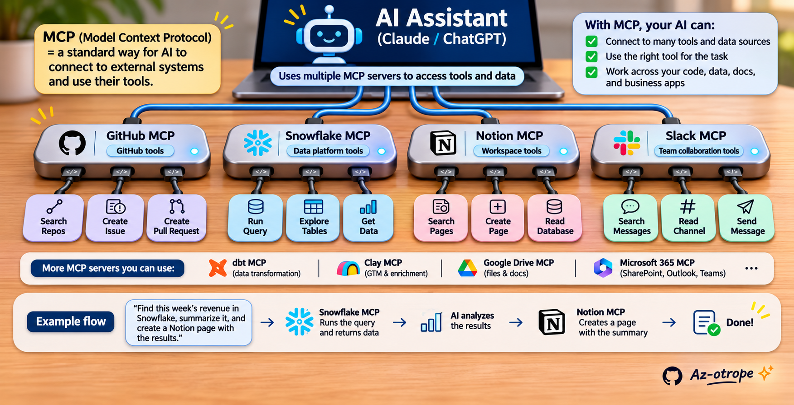
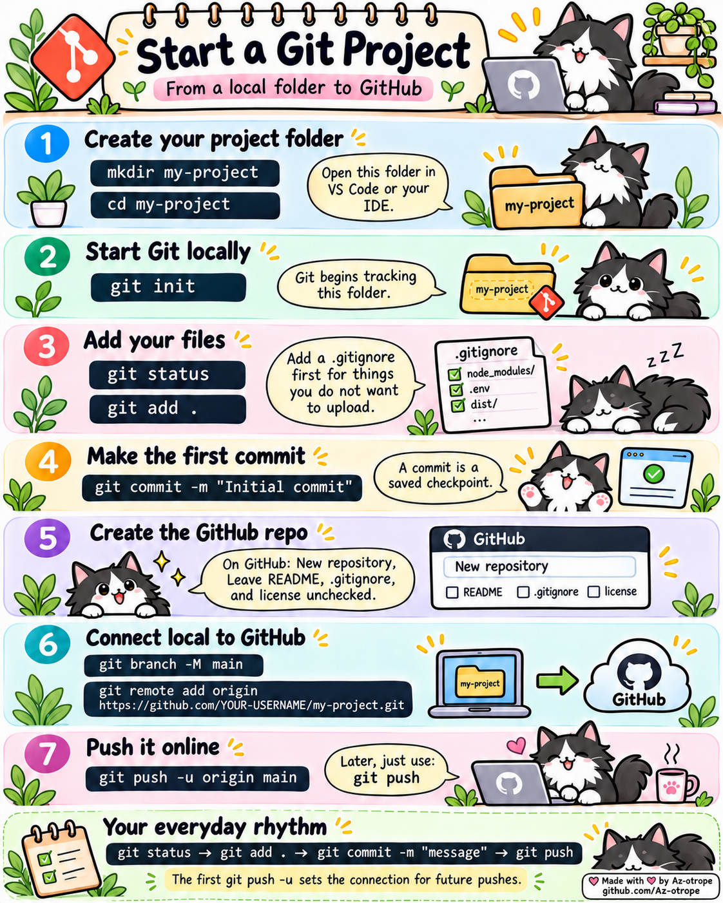
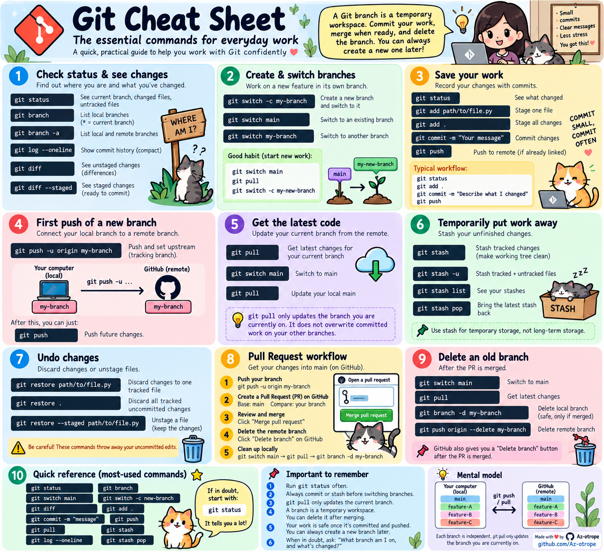

# Visual Tech Notes

Technical concepts, explained visually — the way I wish they had been explained to me.

🌐 **Site:** https://az-otrope.github.io/visual-tech-notes/

## Topics

### 🔌 APIs & Integrations

**MCP: AI Assistants and Their Tool Hubs.** MCP (Model Context Protocol) is a standard way for AI to connect to external systems. Think of USB hubs for your AI.



### 💻 Programming & Developer Tools

**Git: Start a Project.** From a local folder to GitHub in 7 steps.



**Git: Everyday Commands.** Status, branches, commits, stash, PRs and undo.



### Coming soon

- 🔌 **APIs**
- 🧠 **RAG**
- 🛠️ **dbt**
- 🗄️ **Database vs Data Warehouse vs Data Lake**: a simple comparison

## Repo layout

```
visual-tech-notes/
├── index.html      # landing page for GitHub Pages
├── git/            # one folder per topic
├── mcp/
└── README.md
```

---

Made with ♥ by [Az-otrope](https://github.com/Az-otrope)
